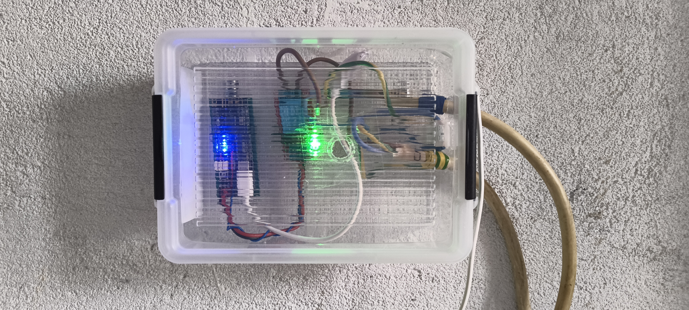
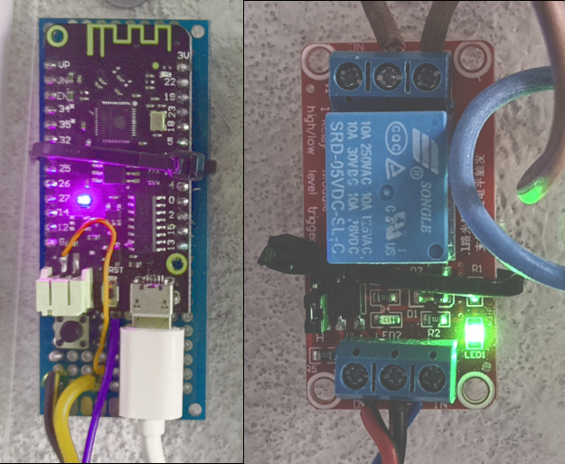
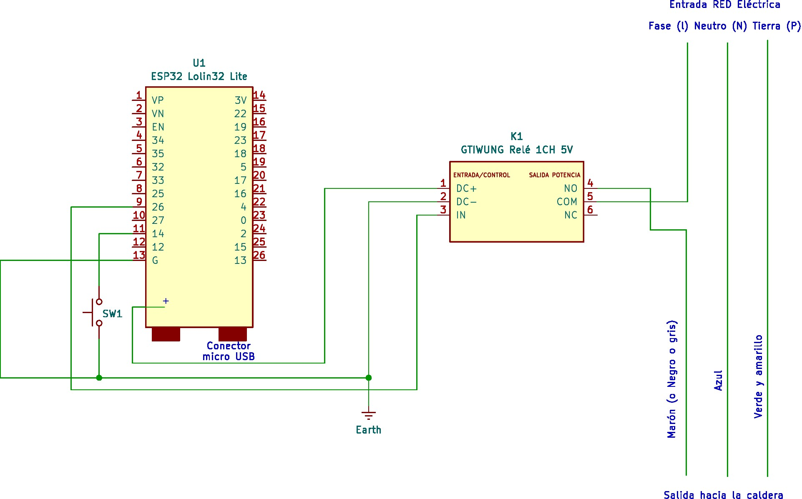

# Control de Caldera por Correo Electrónico - ESP32 Lolin32

**Angel de la Iglesia Gonzalo**

**Versión/rev**: 1/0

**Fecha**: 20261103

**Summary**: In this project, we build a remote boiler control system using email. We use a dedicated Gmail account to receive commands. 

With the emails you can:

- Connect the boiler
- Disconnect the boiler
- Check if it's "Connected" or "Disconnected"

The system replies with the boiler's current status to the email address you used to request it. If there's a power outage and power comes back, the boiler returns to its previous state and sends an email to a specific email address, hardcoded in the program code, to let you know it restarted.

**Resumen**: En este proyecto, se crea un control remoto para calderas que usa correos electrónicos. Para recibir los  comandos se utiliza una cuenta de *Gmail* dedicada.

Con los correos se puede:

- Conectar la caldera
- Desconectar la caldera
- Ver si está "Conectada" o "Desconectada"

El sistema responderá con el estado actual de la caldera al correo que se usó para pedir la información. Si hay un corte de electricidad y luego la alimentación se recupera, la caldera regresa a su estado anterior y envía un correo a una dirección de correo electrónico, definida en el código del programa, para informar que se reinició.

**Licencia**: Este proyecto está bajo la Licencia [*MIT*](https://es.wikipedia.org/wiki/Licencia_MIT) - Ver el fichero [*LICENSE.txt*](./LICENSE.txt).

Este proyecto se ha generado con la ayuda de varias [*IA*](https://es.wikipedia.org/wiki/Inteligencia_artificial), con [*OpenCode*](https://opencode.ai/) y [*Big Pickle*](https://opencode.ai/docs/zen/) y con [Ollama](https://ollama.com/) y [*qwen3:4b*](https://huggingface.co/Qwen/Qwen3-4B) y también con la ayuda de [*Gemini*](https://gemini.google.com/app?hl=es-ES) para las configuraciones de [*Google*](https://www.google.com/).


*Fig.1 - Control remoto funcionando.*

---

> NOTA: Es necesario crear una cuenta dedicada para la gestión del correo electrónico en el *control remoto* construido con el *ESP32*. 

## Configuración de Seguridad en *Gmail* para la cuenta del control remoto

*Google* bloquea las conexiones automatizadas estándar. Para permitir que el ESP32 se conecte, debes seguir este orden estricto:

1. **Cuenta dedicada:** Crea una cuenta de Gmail exclusiva para tu dispositivo (ej. `mi.esp32.iot@gmail.com`). Nunca uses tu cuenta personal.
2. **Verificación en 2 pasos:** Ingresa a la [Configuración de Seguridad de Google](https://google.com) y activa la **Verificación en dos pasos**.
3. **Contraseña de aplicación:** 
   * En el buscador superior de tu cuenta de Google escribe: `"Contraseñas de aplicación"`.
   * Asígnale un nombre (ej. `ESP32-CRemoto`) y haz clic en **Crear**.
   * Copia el **código de 16 caracteres** generado dentro del cuadro amarillo. *Este código reemplazará tu contraseña habitual en el programa del ESP32.*

---

## 1. Criterios de diseño

### 1.1 Separación de dominios eléctricos

El sistema opera en dos dominios eléctricos separados:

- **Dominio de lógica (3.3V DC):** ESP32 Lolin32, circuitos de control, módulo WiFi
- **Dominio de potencia (220V AC):** Circuito de alimentación de la caldera

La separación se logra mediante un **módulo relé con optoacoplador**, que proporciona aislamiento galvánico entre la señal de control (GPIO 26, 3.3V) y el contacto de potencia (COM/NO, 220V AC). Esto protege al ESP32 de sobretensiones, picos de red y fallos en la caldera.

### 1.2 Estrategia de recepción de comandos: IMAP IDLE (push en tiempo real)

Se implementa la estrategia de **IMAP IDLE** en lugar de polling, por las siguientes razones:

- **Latencia ~0 segundos:** Gmail notifica al ESP32 en el instante que llega un correo nuevo
- **Consumo de datos mínimo:** Solo keepalive (~0.2 KB/min) en lugar de ~5 KB por check IMAP
- **Auto-reconexion:** La librería ESP_Mail_Client gestiona los timeouts de conexión y el firmware reintenta explícitamente ante pérdidas de WiFi o IMAP

El ESP32 conecta a Gmail IMAP (imap.gmail.com:993 SSL) y activa IDLE (escucha en tiempo real). Cuando llega un correo nuevo, Gmail notifica al ESP32 vía push. El ESP32 lee el correo, procesa el comando, responde por SMTP y **borra el correo del servidor** usando `deleteMessages(uid, true, true)` (marca `\Deleted` + expunge). Gmail mueve el correo a la Papelera (se elimina definitivamente a los 30 días). No se utiliza memoria local (NVS) para almacenar UIDs: el propio Gmail actúa como lista de tareas pendientes.

La lectura de correos se realiza con criterio de búsqueda **`ALL`**: la librería ESP Mail Client, si el criterio está vacío, solo obtiene el **último mensaje** de INBOX, lo que provoca que los correos anteriores queden sin procesar. Con `ALL` se obtienen **todos** los correos pendientes y se procesan secuencialmente. Como los procesados se borran, en condiciones normales la búsqueda devuelve cero resultados.

Además de las notificaciones IDLE, existe un **barrido periódico cada 2 minutos** que lee la bandeja aunque no haya notificación. Esto cubre el caso de correos cuya notificación IDLE se pierde porque llegaron mientras el ESP32 estaba ocupado enviando una respuesta SMTP.

La conexión IDLE se refresca cada 28 minutos (limite IMAP ~29 min) para evitar la desconexión del servidor.

### 1.3 Normalización de asuntos

Los asuntos de los correos admitidos para el control remoto son:

**encender caldera**

**apagar caldera**

**estado caldera**

Puede escribirse con minúsculas, mayúsculas o mezcla.

Los asuntos de correo se normalizan antes de la comparación para aceptar variaciones:

1. Conversión a minúsculas (`toLowerCase()`)
2. Eliminación de espacios al inicio y final (`trim()`)
3. Colapso de espacios múltiples a un solo espacio

Esto permite que el sistema reconozca comandos escritos como:

- `ENCENDER CALDERA`
- `  Encender   caldera  `
- `Encender Caldera`
- `encender caldera`

Todos se normalizan a `encender caldera` y se comparan con los tres comandos reconocidos.

### 1.4 Idempotencia(*) de comandos

- Tras enviar una respuesta SMTP exitosa, el ESP32 **borra el correo del servidor IMAP** (`addDeletedTag` + `expunge`). En las siguientes revisiones, el correo ya no aparece en INBOX, por lo que no se procesa dos veces.
- Si el SMTP falla, el correo **no se borra** y queda en INBOX para reintentar en el próximo ciclo de lectura.
- Si la caldera ya está encendida y se recibe `encender caldera`, el sistema **no cambia el estado**, **no envía respuesta** y **descarta el correo** (lo borra del servidor). Así el comando redundante no queda acumulado en INBOX ni puede re-ejecutarse más adelante cuando el estado vuelva a cambiar.
- Si la caldera ya está apagada y se recibe `apagar caldera`, comportamiento análogo.
- Los correos con **asunto no reconocido** se **ignoran y se descartan** (se borran del servidor sin enviar respuesta). Esto evita que queden bloqueando el procesamiento de los correos siguientes.
- Solo se envía respuesta cuando hay un **cambio de estado real** o cuando se solicita el **estado de la caldera**. Los comandos redundantes y los asuntos no reconocidos **se descartan** sin tomar ninguna acción que indique esta circunstancia y pasan a la *papelera* de *Gmail*.
- Si el ESP32 se reinicia a mitad del proceso (corte de luz, el correo seguirá en INBOX y se procesara en el próximo ciclo. No hay perdida de comandos.
- Gmail mantiene los correos borrados en la **Papelera durante 30 días**, lo que permite verificar que comandos recibió el ESP32 en caso de dudas.

**Procesamiento secuencial:** Los correos en espera se procesan **uno a uno, por orden de llegada (UID ascendente)**: cada mensaje se ejecuta (acción + respuesta SMTP si procede) y se borra antes de pasar al siguiente. El procesamiento y borrado se realizan **fuera del callback IMAP** (tras completar `readMail()`), para no anidar operaciones SMTP/borrado sobre la sesión IMAP activa. Ademas, al arrancar o reconectar, se hace una lectura inicial que drena los correos acumulados durante la caída aunque no llegue ninguno nuevo.

> **NOTA**: (*)Idempotencia de comandos es la propiedad que tiene un comando (o una operación) por la cual su resultado es exactamente el mismo si se ejecuta una sola vez o si se ejecuta muchas veces seguidas.

> **NOTA**: Al principio hay que vigilar que los correos enviados al control remoto no acaben en la bandeja de *"correo no deseado"* (o *"spam"*) para evitar que sean ignorados. En caso de que esto ocurra el procedimiento para sacarlos de *"correo no deseado"* se presenta en el apartado siguiente. 

#### Pasos para configurar el filtro de *correo no deseado*

1. **Abre Gmail** en tu navegador web.
2. Haz clic en el icono de **Configuración** (la rueda dentada arriba a la derecha) y selecciona **Ver toda la configuración**.
3. Ve a la pestaña **Filtros y direcciones bloqueadas** y haz clic en **Crear un nuevo filtro**.
4. Define dónde buscar las palabras clave:
   * Si las palabras deben estar **estrictamente en el título**, escríbelas en el campo **Asunto**. Es nuestro caso.
   * Si pueden estar **en cualquier parte del correo**, escríbelas en el campo **Contiene las palabras**. No es necesario para nuestro caso.
5. Escribe tus palabras clave separadas por la palabra **`OR`** (en mayúsculas) para que el filtro actúe si detecta cualquiera de ellas:
   `Caldera OR Encender OR Apagar OR Estado`. *Gmail* no discrimina por mayúsculas, minúsculas o mezcla de ellas.
6. Haz clic en **Crear filtro** (en la esquina inferior derecha).
7. Marca la casilla **No marcar nunca como spam**.
8. Si quieres rescatar los correos que ya cayeron en la carpeta de Spam, marca la casilla **Aplicar también el filtro a las conversaciones que coincidan**.
9. Haz clic en **Crear filtro** para finalizar.

### 1.5 Resiliencia del sistema

- **Conexionar WiFi:** Si la conexión WiFi se pierde, el ESP32 reintenta automáticamente en ciclos de hasta 40 intentos x 500 ms (20 s por ciclo); el bucle principal repite el ciclo indefinidamente hasta recuperar la conexión
- **Error IMAP/SMTP:** Si falla la conexión al servidor de correo, el ESP32 reintenta reconectar automáticamente (guarda de 10 s entre intentos)
- **Estado de caldera en flash (NVS):** Cada cambio de estado (encendido/apagado) se guarda en la memoria flash del ESP32 mediante la librería `Preferences` (NVS). Tras un corte de alimentación o reinicio, el sistema recupera automáticamente el estado que tenía antes del corte y activa el relé en consecuencia
- **Correo de aviso de reinicio:** En cada arranque (una vez conectado el WiFi), el sistema envía un correo a `EMAIL_REINICIO` con asunto `Reinicio de caldera` y el cuerpo `El sistema se ha reiniciado tras un corte de alimentación` seguido de la linea `Estado actual caldera encendida` o `Estado actual caldera apagada`. Esto permite detectar cortes de luz aunque nadie haya interactuado con el sistema
- **Borrado en servidor:** Los correos procesados se eliminan del INBOX de Gmail. No se utiliza memoria local para persistir UIDs. Si el ESP32 se reinicia, los correos no procesados siguen en INBOX y se procesan en el próximo ciclo
- **Reintento automático:** Si el SMTP falla al enviar una respuesta, el correo no se borra del servidor y se reintenta en el próximo ciclo de lectura IMAP

### 1.6 Personalización del código

Para que el *control remoto* actúe y responda adecuadamente es necesario escribir en el código las credenciales necesarias:

```sh
// ===================== CREDENCIALES - REEMPLAZAR =====================
#define WIFI_SSID         "YOUR_WIFI_SSID"
#define WIFI_PASSWORD     "YOUR_WIFI_PASSWORD"
#define EMAIL_ACCOUNT     "YOUR_EMAIL@gmail.com"
#define EMAIL_PASSWORD    "YOUR_APP_PASSWORD"
#define EMAIL_REINICIO    "EMAIL_REINICIO@gmail.com"
// ======================================================================
```

`"YOUR_WIFI_SSID"` Es el nombre de tu red *WIFI*.

`"YOUR_WIFI_PASSWORD"` Es la clave de tu red *WIFI*.

`"YOUR_EMAIL@gmail.com"` Es la dirección de correo creada para el Control remoto.

`"YOUR_APP_PASSWORD"` Es el código de 16 dígitos que te han proporcionado al generar la cuenta. La contraseña se verá como algo semejante a `"atvrasuoxxggtxrs"`.

`"EMAIL_REINICIO@gmail.com"` Es la cuenta de correo donde quieres recibir los mensajes del control remoto en caso de reinicio (por fallo de la red de alimentación, por ejemplo). Puedes enviar los correos para encender, apagar o saber el estado de la caldera desde cualquier cuenta de correo operativa; las respuestas serán enviadas a la dirección de correo que solicitó la acción, pero los reinicios serán únicamente enviados a la dirección que se haya definido en `EMAIL_REINICIO`.

#### Seguridad

- **App Password:** Gmail requiere una contraseña de aplicación (no la contraseña normal de la cuenta) desde mayo de 2022
- **SSL/TLS:** Tanto IMAP (puerto 993) como SMTP (puerto 465) operan sobre conexión cifrada
- **NTP:** Sincronización de hora para las operaciones IMAP
- **Aislamiento galvánico:** El optoacoplador del relé protege el ESP32 del dominio de 220V

#### Zona horaria

El sistema utiliza **`configTzTime()`** con cadenas POSIX para gestionar automáticamente el horario de verano e invierno. Selecciona tu país descomentando la línea correspondiente en el código:

```cpp
// ===================== ZONA HORARIA - SELECCIONAR PAIS =====================
#define TZ_SPAIN       "CET-1CEST,M3.5.0,M10.5.0/3"    // Espana peninsular
// #define TZ_PORTUGAL  "WET-0WEST,M3.5.0,M10.5.0/1"    // Portugal
// #define TZ_FRANCE    "CET-1CEST,M3.5.0,M10.5.0/3"    // Francia
// #define TZ_GERMANY   "CET-1CEST,M3.5.0,M10.5.0/3"    // Alemania
// #define TZ_UK        "GMT0BST,M3.5.0,M10.5.0"        // Reino Unido
// #define TZ_ITALY     "CET-1CEST,M3.5.0,M10.5.0/3"    // Italia
// #define TZ_ARGENTINA "ART3"                            // Argentina (sin DST)
// #define TZ_MEXICO    "CST6CDT,M4.1.0,M10.5.0"        // Mexico (CDMX)
// #define TZ_US_EAST   "EST5EDT,M3.2.0,M11.1.0"        // EE.UU. este
//
#define MY_TZ  TZ_SPAIN    // <--- seleccionar aqui
// ===========================================================================
```

La cadena POSIX incluye las reglas de cambio de hora (ej. último domingo de marzo a las 2:00 → +1h, último domingo de octubre a las 3:00 → -1h). La lista completa de cadenas está disponible en: https://github.com/esp8266/Arduino/blob/master/cores/esp8266/TZ.h

> **NOTA IMPORTANTE SOBRE SEGURIDAD**: Cualquier persona que conozca la dirección de correo electrónico puede controlar la caldera si conoce además los comandos. Para evitar este problema se puede crear un filtro en *Gmail* semejante al que hicimos para los *correos no deseados*. El procedimiento es el siguiente:

#### Pasos para configurar el filtro de selección de correos válidos

1. **Abre Gmail** en tu navegador web en el ordenador.
2. Haz clic en el icono de **Configuración** (la rueda dentada arriba a la derecha) y selecciona **Ver toda la configuración**.
3. Ve a la pestaña **Filtros y direcciones bloqueadas** y haz clic en **Crear un nuevo filtro**.
4. En el campo **De**, escribe la siguiente fórmula exacta (reemplazando los ejemplos con las cuentas permitidas):
   `-{correo1@gmail.com correo2@gmail.com ...}`
   * *Nota: El signo de menos `-` excluye esas cuentas, y las llaves `{ }` actúan como el operador lógico "O". Deja un espacio entre los correos.*
5. Haz clic en **Crear filtro** (en la esquina inferior derecha del cuadro).
6. Selecciona la acción marcando la casilla **Eliminar**.
7. Si deseas borrar los correos antiguos acumulados, marca **Aplicar también el filtro a las conversaciones que coincidan**.
8. Haz clic en **Crear filtro** para finalizar.

### 1.7 Estrategia de borrado en servidor Gmail

El ESP32 **no utiliza memoria local** para almacenar UIDs de correos procesados. En su lugar, elimina los correos del servidor IMAP tras procesarlos. Esto convierte a Gmail en la "lista de tareas pendientes": si un correo está en INBOX, se procesa; si se procesó, se borró.

**Flujo de borrado (orden crítico):**

1. El ESP32 detecta un nuevo correo vía IMAP IDLE (push en tiempo real) o vía barrido periódico (cada 2 min)
2. Lee **todos** los correos pendientes por IMAP (búsqueda `ALL`) y los procesa secuencialmente, uno a uno por orden de llegada
3. Si coincide con un comando válido, envía la respuesta por SMTP; si el asunto no es reconocido, lo descarta sin respuesta
4. Solo si el SMTP retorna "OK" (o si el correo es descartable), el ESP32 ejecuta `deleteMessages(uid, true, true)` para borrar el correo antes de pasar al siguiente
5. Si el SMTP falla, el correo **no se borra** y se reintenta en el próximo ciclo

**Ventajas de este enfoque:**

- **Adiós a duplicados por hardware:** Si reseteas el ESP32, se corta la luz o compras un ESP32 nuevo, jamas responderá a un correo antiguo porque el correo ya no existe en Gmail
- **Memoria dedicada a UIDs = cero:** No se necesita buffer circular ni almacenamiento de UIDs procesados. La NVS (Preferences) se utiliza unicamente para persistir el estado ON/OFF de la caldera entre reinicios, no para gestionar correos
- **Auto-limpieza:** Gmail elimina los correos de la Papelera automáticamente a los 30 días. No hay acumulación de datos
- **Resistencia a reinicios:** Si el ESP32 se apaga a mitad del proceso (SMTP enviado pero antes del IMAP delete), el correo seguirá en INBOX. En el próximo ciclo, el ESP32 lo verá como "nuevo" pero como la caldera ya cambió de estado, lo descartara sin enviar respuesta ni duplicar la acción (Idempotencia). Si el usuario necesita repetir el comando, puede reenviar el correo

**Comandos reconocidos:**

| Asunto del correo                         | Acción                                | Responde              | Borra                       |
| ----------------------------------------- | ------------------------------------- | --------------------- | --------------------------- |
| `encender caldera`                        | Enciende la caldera (si está apagada) | Sí (cambio de estado) | Sí SMTP OK                  |
| `apagar caldera`                          | Apaga la caldera (si está encendida)  | Sí (cambio de estado) | Sí SMTP OK                  |
| `estado caldera`                          | Consulta el estado actual             | Siempre               | Sí SMTP OK                  |
| Comando redundante (sin cambio de estado) | Sin cambio                            | No                    | Sí (descarte)               |
| Cualquier otro                            | Ignorado                              | No                    | Sí (descarte sin respuesta) |

**Nota sobre Gmail y el borrado:**
Cuando se ejecuta `deleteMessages(uid, true, true)` vía IMAP, Gmail mueve automáticamente el correo a la carpeta "Papelera" (Trash) y lo mantiene durante 30 días. Esto permite verificar que comandos recibió el ESP32 en caso de cualquier fallo.

### 1.8 Prueba del relé por botón (GPIO 14)

El sistema incorpora un **botón pulsador físico** que permite probar la conmutación del relé (y el actuador/caldera conectado) sin necesidad de enviar correos. Sirve para verificar de forma inmediata que el relé, el cableado de 220V y el dispositivo final funcionan correctamente durante el montaje o mantenimiento y se puede sustituir la caldera por una bombilla de 220V, o cualquier otra carga útil, para hacer la prueba sin realizar arranques o apagados en la caldera.

**Especificación de la prueba:**

- Una pulsación del botón (GPIO 14 a GND) inicia la secuencia: **3 ciclos de 10 segundos ON + 10 segundos OFF** (duración total ~60 s).
- La secuencia **siempre comienza con el relé en ON**, independientemente del estado actual de la caldera.
- Al terminar la prueba, el relé **se restaura automáticamente al estado real** de la caldera (`calderaOn`) recuperado de la flash (NVS), para no dejar la caldera en un estado inconsistente.

**Comportamiento durante la prueba:**

- **No se envía ningún correo** (ni respuestas ni avisos) mientras dura la prueba.
- **No se procesa la operatividad normal:** los correos que lleguen durante la prueba **no se leen ni se procesan**; permanecen en INBOX de Gmail.
- **Al finalizar**, el sistema reanuda la operación normal y los correos acumulados se procesan en el siguiente ciclo (notificación IDLE, barrido periódico de 2 min o refresco de la conexión).

**Implementación (no bloqueante):**

- La prueba se ejecuta como una **maquina de estados basada en `millis()`** dentro de `loop()`, por lo que no bloquea la ejecución ni interfiere con los timers del sistema.
- El botón se configura con **pull-up interno** (`INPUT_PULLUP`): el pin 14 se lee como LOW al pulsar (botón conectado a GND). No se requiere resistencia externa.
- Se aplica **debounce de 50 ms** y un bloqueo de repetición rápida (~300 ms) para evitar disparos múltiples por rebotes o pulsaciones accidentales.
- El GPIO 14 es un pin libre del Lolin32, definido en el código como `TEST_BUTTON_PIN`.

**Consumo de datos/correo:** la prueba no genera tráfico de correo alguno, por lo que no consume cuota de envío SMTP ni deja mensajes en la Papelera de Gmail.

---

## 2. Componentes hardware necesarios

Los componentes para la realización de este sistema se resumen en la siguiente tabla.

| #   | Componente                           | Especificaciones                                                                                                                                                                                    | Cantidad |
| --- | ------------------------------------ | --------------------------------------------------------------------------------------------------------------------------------------------------------------------------------------------------- | -------- |
| 1   | ESP32 Lolin32 (WEMOS) / LoLin32 Lite | ESP32-WROOM-32, dual-core 240 MHz, 4 MB Flash, WiFi 802.11 b/g/n, Bluetooth 4.2, 3.3V logica. **Nota:** la variante **Lite** (ASIN `B086V1P4BL`) NO expone el pin 5V/VIN en el header (solo 3V y G) | 1        |
| 2   | Módulo relé 1 canal 5V (GTIWUNG)     | Relé SPDT (NO/COM/NC) con optoacoplador SMD. Pinout: DC+ (+5V), DC- (GND), IN (control). Jumper High/Low trigger. Contactos: 10A 250VAC / 10A 30VDC. Disparo: 2-4 mA.                               | 1        |
| 3   | Fuente de alimentación USB 5V/2A     | Adaptador de pared micro-USB, mínimo 5V 2A (10W). Se recomienda una marca de calidad para evitar ruido eléctrico                                                                                    | 1        |
| 4   | Cable micro-USB                      | Cable de datos/carga, longitud según la ubicación del ESP32                                                                                                                                         | 1        |
| 5   | Cables jumper hembra-macho           | Para conectar GPIO 26 y GND al relé (IN/DC-) y llevar 5V externo y GND al DC+/DC-, y GPIO 14/GND al botón de prueba                                                                                 | 5        |
| 6   | Caja de protección                   | Recipiente plástico (IP65 recomendado) para alojar el ESP32 y el módulo relé, separando las conexiones de 220V                                                                                      | 1        |
| 7   | Terminal block / bornes              | Para las conexiones de 220V AC entre el relé y la caldera. Mínimo 2 polos (fase + neutro), Capacidad nominal 10A 250V                                                                               | 1 par    |
| 8   | Boton pulsador (opcional)            | Pulsador normalmente abierto (NA), tipo tactil o interruptor. Conecta GPIO 14 a GND. Usa el pull-up interno del ESP32 (no requiere resistencias externas)                                           | 1        |

### Notas sobre el ESP32 Lolin 32 y el módulo relé (GTIWUNG)

- El módulo relé tiene **optoacoplador** que proporciona aislamiento galvánico entre el pin de control (IN) y el contacto de potencia
- **Pinout de entrada del GTIWUNG:** `DC+` (alimentar con 5V), `DC-` (GND), `IN` (señal de control). No utiliza el esquema VCC/GND/JD-VCC de otros módulos
- **Alimentacion del DC+:** en la **LoLin32 Lite** no hay pin 5V en los *pines* accesibles. Para este proyecto se toma la alimentación disponible en el terminal de conexión para la batería recargable. En la foto siguiente se puede apreciar el cable soldado para alimentar el relé. **IMPORTANTE**: Hay que destacar que este *pin* no está pensado para esta función, pero en mi implementación funciona.


*Fig.2 - Toma de alimentación para el relé y conexionado del relé.*

- **Jumper High/Low trigger:** configurar en **HIGH trigger**, porque el código usa `digitalWrite(RELAY_PIN, HIGH)` para encender la caldera. Si el módulo viene en LOW trigger por defecto, cambiar el jumper o invertir la lógica en el código
- Usar el contacto **NO** (Normally Open) para que la caldera este apagada por defecto cuando el relé está desenergizado
- Si se desea aislamiento completo de la alimentación de la bobina del relé, alimentar `DC+`/`DC-` desde una fuente 5V separada en lugar de desde el ESP32

---

## 3. Esquema eléctrico

### 3.1 Diagrama simplificado

El esquema eléctrico del control remoto se ve en la siguiente figura. 

 
*Fig.3 - Esquema eléctrico del control remoto de caldera.*

> **NOTA IMPORTANTE**: La tierra del circuito de corriente continua (Earth en el esquema) **NO** tiene nada que ver con el cable de *Tierra* (o *Protección*) de los cables de la línea de corriente alterna de 220 V.

### 3.2 Tabla de conexiones

| #   | Desde                                                                                                              | A                    | Conector/pin       | Descripción                                              |
| --- | ------------------------------------------------------------------------------------------------------------------ | -------------------- | ------------------ | -------------------------------------------------------- |
| 1   | GPIO 26                                                                                                            | Relé IN              | Cable              | Señal de control: HIGH enciende la caldera, LOW la apaga |
| 2   | Desde el conector + de carga de batería (soldado). No está pensado para esta función, pero en mi montaje funciona. | Relé DC+             | Cable              | Alimenta la bobina del relé (5V).                        |
| 3   | GND                                                                                                                | Relé DC-             | Cable              | Referencia común ESP32 + relé                            |
| 4   | GND                                                                                                                | Botón terminal 2     | Cable              | Retorno del botón de prueba                              |
| 5   | GPIO 14                                                                                                            | Botón terminal 1     | Cable              | Entrada del botón (pull-up interno; LOW al pulsar)       |
| 6   | Fase (L)                                                                                                           | Relé COM             | Cable 220V / borne | Entrada de fase al relé                                  |
| 7   | Relé NO                                                                                                            | Fase (L) caldera     | Cable 220V / borne | Fase conmutada hacia la caldera                          |
| 8   | Neutro (N) red                                                                                                     | Neutro (N) caldera   | Cable 220V / borne | Directo, no pasa por el relé                             |
| 9   | Tierra o Protección (P)                                                                                            | Tierra o (P) caldera | Cable 220V / borne | Directo, no pasa por el relé                             |

**Notas:**

- Colocar un **fusible de 10A** en la linea de fase (entre la red y COM del relé) si tu circuito no tiene protección externa.
- El contacto **NC** del relé no se utiliza (Normalmente Conectado)
- La caldera está **apagada** cuando el relé está desenergizado (contacto NO abierto)
- La GND del relé se comparte con la del ESP32

### 3.3 Botón de prueba (opcional)

```
    ESP32 Lolin32                Botón pulsador (NA)
    ===============              ====================

    GPIO 14  o----------------------o Terminal 1 (NO)

    GND      o----------------------o Terminal 2 (COM)

    (El pull-up interno del GPIO 14 elimina la necesidad de resistencias externas.
     Botón sin pulsar: pin en HIGH. Botón pulsado: pin conectado a GND -> LOW.)
```

---

## 4. Consideraciones de montaje

### 4.1 Seguridad eléctrica

- **PRECAUCIÓN:** El proyecto maneja 220V AC. Las conexiones de alta tensión deben realizarse con el sistema **DESCONECTADO** de la toma de corriente
- Usar cable de sección mínima **1.5 mm²** para las conexiones de 220V
- Todas las conexiones de 220V deben estar en **bornes o conectores certificados** (no simplemente retorcidos)
- El módulo relé debe estar en una **caja de protección** con tapa, accesible solo para mantenimiento
- Instalar un **fusible de protección** (10A) en la linea de fase antes del relé si es necesario
- **Nunca** abrir la caja de protección con el sistema energizado

### 4.2 Separación física

- Mantener una **distancia mínima de 5 cm** entre las conexiones de 3.3V/5V (lógica) y las conexiones de 220V (potencia)
- El módulo relé debe estar **físicamente separado** del ESP32 dentro de la caja, o en compartimentos diferentes
- Si es posible, usar una caja con **dos compartimentos**: uno para lógica (ESP32 + relé) y otro para las conexiones de 220V

### 4.3 Ubicación del sistema

- Instalar el sistema en un lugar **seco y ventilado**, lejos de fuentes de calor directo (la caldera genera calor)
- Evitar la exposición directa a agua o humedad
- El ESP32 debe estar en un lugar con **buena recepción WiFi** (señal mínima de -70 dBm)
- La fuente USB debe estar accesible para mantenimiento

### 4.4 Protección contra sobretensiones

- El módulo relé con optoacoplador ya incluye protección básica (diodo flyback)
- Se recomienda instalar un **varistor (MOV)** en paralelo con los contactos del relé para proteger contra picos de red (No implementado)
- La fuente USB debe tener protección contra sobrecorriente y cortocircuito

### 4.5 Verificación del sistema

Antes de conectar la caldera:

1. Verificar el estado del relé con un multímetro (continuidad en NO/COM)
2. Probar los comandos de correo y comprobar que el relé cambia de estado y que no acaban en la bandeja de *"correo no deseado"* o *"spam"*
3. Verificar con un multímetro que el relé corta/alimenta los 220V correctamente
4. Confirmar que el ESP32 responde al correo "estado caldera"
5. Comprobar en el monitor serial de *Arduino IDE* que los correos procesados se eliminan del servidor con `deleteMessages()` (mensajes ">> Correo eliminado de Gmail")
6. Verificar en la cuenta de Gmail que los correos procesados aparecen en la Papelera
7. Probar la recuperación tras corte: con la caldera encendida vía correo, cortar la alimentación del ESP32 y restablecerla. Verificar en el monitor serial que el relé recupera el estado (`[INIT] ... estado recuperado de flash`) y que llega a `EMAIL_REINICIO` el correo "Reinicio de caldera" indicando el estado actual
8. Probar el botón de prueba (si se instala): pulsarlo y comprobar en el monitor serial la secuencia `[PRUEBA] ... ON (10 s)` / `OFF (10 s)` durante 3 ciclos, el mensaje `[PRUEBA] >>> PRUEBA FINALIZADA <<<` y que el relé vuelve al estado real al terminar. Verificar también que durante la prueba los correos entrantes quedan en INBOX y se procesan al finalizar

### 4.6 Nota: configurar IP estática sin tocar el router (No implementado)

Es posible forzar una IP fija en el ESP32 (ej. 192.168.1.113) sin modificar la configuracion del router, usando `WiFi.config()` antes de `WiFi.begin()`:

```cpp
IPAddress local_IP(192, 168, 1, 113);
IPAddress gateway(192, 168, 1, 1);
IPAddress subnet(255, 255, 255, 0);
IPAddress primaryDNS(8, 8, 8, 8);
IPAddress secondaryDNS(8, 8, 4, 4);

WiFi.config(local_IP, gateway, subnet, primaryDNS, secondaryDNS);
WiFi.begin(WIFI_SSID, WIFI_PASSWORD);
```

**Consideraciones:**

- La IP debe estar **fuera del rango DHCP** del router para evitar conflictos. Si el router reparte IPs desde 192.168.1.100 a 192.168.1.200, usar una fuera de ese rango (ej. 192.168.1.2 o 192.168.1.250)
- Si el router ya tiene esa IP asignada a otro dispositivo, habrá conflicto (ambos pierden conectividad)
- Es recomendable reservar la IP en el router (DHCP reservation) para evitar conflictos a largo plazo, aunque no es obligatorio
- El `gateway` debe ser la IP del router (normalmente 192.168.1.1 o 192.168.0.1)

### 4.7 Convivencia con otros ESP32 en la misma red

Este sistema es **autónomo e independiente**: no depende de ningún otro ESP32, no actúa como maestro ni esclavo, y no mantiene estado compartido con otros dispositivos. Otros posibles ESP32 de la red (radio por internet, termostato, etc.) pueden coexistir sin ninguna interacción, tengan o no función de correo.

Consideraciones para un entorno domestico con **2 - 4 ESP32**:

- **Direccionamiento:** el router asigna IP por DHCP en orden de asociación. **No usar IP estática** (o si se usa, reservar una IP DHCP única por dispositivo y fuera del rango activo) para evitar colisiones de IP entre dispositivos
- **Arranque simultaneo tras un corte de luz:** todos los ESP32 de la misma red se rearrancan a la vez y se asocian al AP en rápida sucesión. Con 3 - 4 dispositivos no supone problema para un router domestico; los reintentos WiFi del firmware (hasta 40 x 500 ms por ciclo) cubren posibles rechazos momentáneos del AP
- **Rafaga de correos de reinicio:** si varios dispositivos enviaran aviso por correo al arrancar, el pico es irrelevante a esta escala (sección 6: ~11 KB por reinicio). Este proyecto solo envía el aviso "Reinicio de caldera" una vez al arranque
- **Sin coordinacion entre ESP32:** si un dispositivo se cae o se reinicia, no afecta a los demás. La única dependencia común es la conexión WiFi/Internet (y, en este proyecto, la cuenta de Gmail propia)
- **Escalonamiento opcional:** si se quisiera suavizar aun mas la reconexión tras un apagón, se puede escalar el arranque con un `delay()` inicial de 0 - 15 s por dispositivo (p.ej. basado en el último byte de su MAC). No es necesario a esta escala

---

## 5. Estimación de consumo eléctrico (ESP32 + periféricos)

### 5.1 Consumo por componente

| Componente             | Modo de operación                                        | Corriente típica | Corriente máxima |
| ---------------------- | -------------------------------------------------------- | ---------------- | ---------------- |
| ESP32 (chip)           | WiFi TX (transmisión IMAP/SMTP)                          | 180 mA           | 240 mA           |
| ESP32 (chip)           | WiFi RX (recepción)                                      | 95 mA            | 100 mA           |
| ESP32 (chip)           | WiFi idle (conectado, sin TX/RX)                         | 15 mA            | 20 mA            |
| ESP32 (chip)           | Modem sleep (CPU on, radio off)                          | 15 mA            | 30 mA            |
| Módulo Lolin32         | Quiescente (regulador LDO + USB-UART CP2102/CH340 + LED) | 8 mA             | 15 mA            |
| módulo relé            | Bobina energizada (caldera ON)                           | 70 mA            | 80 mA            |
| módulo relé            | Bobina desenergizada (caldera OFF)                       | 0 mA             | 0 mA             |
| LED indicador del relé | Encendido (caldera ON)                                   | 3 mA             | 5 mA             |

### 5.2 Consumo promedio con IMAP IDLE

Con IMAP IDLE, el ESP32 mantiene una conexión TCP permanente con el servidor IMAP:

**Estado IDLE (mayor parte del tiempo):**

- WiFi conectado con IDLE activo: ~15 mA (chip) + 8 mA (módulo) = 23 mA
- La conexión TCP permanente no incrementa significativamente el consumo

**Estado activo (al recibir mensaje):**

- IMAP fetch + SMTP envió + borrado: ~180 mA promedio durante ~6 - 15 s
- Energía: 180 mA x 6 - 15 s = 1080 - 2700 mAs

**Barrido periodico (cada 2 minutos):**

- Búsqueda SEARCH ALL con bandeja vacía: ~180 mA durante ~0,3 - 1 s
- Energía: 720 barridos/día x 180 mA x 0,3 - 1 s = ~11 - 36 mAh/dia (< 5% del total diario)
- Si el barrido encuentra mensajes pendientes, el coste es el del estado activo por cada uno

**Refresco de conexión (cada 28 minutos):**

- Desconexión + conexionar IMAP: ~180 mA durante ~3 segundos
- Energía: 180 mA x 3s = 540 mAs

### 5.3 Consumo total del sistema

| Estado             | Módulo ESP32 | Relé  | LED relé | **Total**  |
| ------------------ | ------------ | ----- | -------- | ---------- |
| Caldera OFF (IDLE) | ~23 mA       | 0 mA  | 0 mA     | **~23 mA** |
| Caldera ON (IDLE)  | ~23 mA       | 70 mA | 3 mA     | **~96 mA** |

### 5.4 Consumo diario y mensual

| Estado      | Consumo diario                       | Consumo mensual (30 días) |
| ----------- | ------------------------------------ | ------------------------- |
| Caldera OFF | 23 mA x 24h = **552 mAh**            | **16560 mAh** (~16,5 Ah)  |
| Caldera ON  | 96 mA x 24h = **2304 mAh** (~2,3 Ah) | **69120 mAh** (~69 Ah)    |

### 5.5 Alimentación recomendada

- **Fuente USB:** 5V / 2A (10W) - suficiente para ambos casos
- **No se recomienda** alimentar el sistema desde la salida 3.3V del ESP32 (insuficiente corriente para el relé)

### 5.6 Nota sobre el modo Deep Sleep

Este proyecto **no utiliza Deep Sleep** porque necesita mantener la conexión IMAP IDLE activa para recibir notificaciones push en tiempo real. El modo IDLE consume corriente en el modem WiFi pero permite latencia ~0 segundos. Para una caldera conectada a red eléctrica, el consumo actual es despreciable.


---

## 6. Estimación de consumo de datos (10 mensajes/semana)

### 6.1 Consumo de datos con IMAP IDLE

Con IMAP IDLE, el consumo de datos es significativamente menor que con polling:

- **Conexión inicial:** ~5 KB (TLS handshake + LOGIN + SELECT INBOX + IDLE)
- **Keepalive:** ~0.2 KB por minuto (paquetes TCP keepalive del servidor)
- **Barrido periódico cada 2 min:** ~0.5 KB por barrido con bandeja vacía (SEARCH ALL sin resultados)
- **Por mensaje nuevo:** ~3.7 KB (FETCH headers) + ~5.5 KB (SMTP respuesta)
- **Refresco cada 28 minutos:** ~5 KB por reconexión completa (TLS handshake + LOGIN + SELECT)
- **Por reinicio:** ~11 KB adicionales (correo de aviso SMTP a EMAIL_REINICIO + reconexión IMAP)

### 6.2 Consumo de datos por operación

**Conexión inicial IMAP IDLE:**

| Fase                                                        | Datos aproximados        |
| ----------------------------------------------------------- | ------------------------ |
| TCP handshake (3 paquetes)                                  | ~200 bytes               |
| TLS handshake (ClientHello, ServerHello, certificado, etc.) | ~3.000 bytes             |
| IMAP: CAPABILITY, LOGIN, SELECT INBOX                       | ~1.500 bytes             |
| IMAP: IDLE (activacion)                                     | ~200 bytes               |
| **Total por conexión**                                      | **~5.000 bytes (~5 KB)** |

**Keepalive IDLE (por minuto):**

| Fase                         | Datos aproximados        |
| ---------------------------- | ------------------------ |
| IMAP: KEEPALIVE del servidor | ~100 bytes               |
| TCP keepalive                | ~100 bytes               |
| **Total por minuto**         | **~200 bytes (~0.2 KB)** |

**Barrido periódico (cada 2 min, bandeja vacía):**

| Fase                                       | Datos aproximados        |
| ------------------------------------------ | ------------------------ |
| IMAP: SEARCH ALL (comando)                 | ~50 bytes                |
| IMAP: Respuesta tagged OK (sin resultados) | ~100 bytes               |
| Overhead TCP/TLS por transacción           | ~350 bytes               |
| **Total por barrido**                      | **~500 bytes (~0.5 KB)** |

**Refresco de conexión (cada 28 min):**

| Fase                                                 | Datos aproximados |
| ---------------------------------------------------- | ----------------- |
| Reconexión completa (idéntica a la conexion inicial) | ~5 KB             |
| **Total por Refresco**                               | **~5 KB**         |

**Cuando hay 1 mensaje nuevo:**

| Fase                                       | Datos aproximados          |
| ------------------------------------------ | -------------------------- |
| IMAP: Notificación IDLE                    | ~200 bytes                 |
| IMAP: FETCH (headers del mensaje)          | ~2.000 bytes               |
| IMAP: Respuesta con asunto, remitente, UID | ~1.500 bytes               |
| **Total adicional por mensaje**            | **~3.700 bytes (~3.7 KB)** |

**Cada envío SMTP (respuesta al usuario):**

| Fase                                             | Datos aproximados          |
| ------------------------------------------------ | -------------------------- |
| TCP handshake                                    | ~200 bytes                 |
| TLS handshake                                    | ~3.000 bytes               |
| SMTP: EHLO, AUTH LOGIN, MAIL FROM, RCPT TO, DATA | ~2.000 bytes               |
| SMTP: Cuerpo del mensaje (asunto + texto)        | ~200 bytes                 |
| SMTP: QUIT                                       | ~100 bytes                 |
| **Total por envió SMTP**                         | **~5.500 bytes (~5.5 KB)** |

### 6.3 Estimación semanal (10 mensajes)

| Concepto                         | Calculo                                     | Datos                   |
| -------------------------------- | ------------------------------------------- | ----------------------- |
| Conexión inicial IMAP IDLE       | 1 x 5 KB                                    | **5 KB**                |
| Keepalive (7 dias)               | 7 dias x 24h x 60min x 0.2 KB               | **20.160 KB** (~20 MB)  |
| Barridos periódicos (cada 2 min) | (7 x 24 x 60 / 2) x 0.5 KB = 5.040 barridos | **2.520 KB** (~2.5 MB)  |
| Refresco IDLE (cada 28 min)      | (7 x 24 x 60 / 28) x 5 KB = 360 Refresco    | **1.800 KB** (~1.8 MB)  |
| Mensajes nuevos                  | 10 x 3.7 KB (IMAP fetch)                    | **37 KB** (~0.04 MB)    |
| Respuestas SMTP                  | 10 x 5.5 KB                                 | **55 KB** (~0.06 MB)    |
| **Total semanal**                |                                             | **~24.577 KB** (~24 MB) |

### 6.4 Estimación mensual

| Concepto                         | Datos                                                                    |
| -------------------------------- | ------------------------------------------------------------------------ |
| Keepalive IDLE (30 días)         | 30 x 24 x 60 x 0.2 KB = **86.400 KB** (~86 MB)                           |
| Barridos periódicos (cada 2 min) | (30 x 24 x 60 / 2) x 0.5 KB = 21.600 barridos = **10.800 KB** (~10.8 MB) |
| Refresco IDLE (30 dias)          | (30 x 24 x 60 / 28) x 5 KB = 1.543 Refresco = **7.715 KB** (~7.7 MB)     |
| Mensajes nuevos (40 msgs/mes)    | 40 x 3.7 KB = **148 KB** (~0.15 MB)                                      |
| SMTP respuestas (40 msgs/mes)    | 40 x 5.5 KB = **220 KB** (~0.22 MB)                                      |
| **Total mensual**                | **~105.283 KB** (~103 MB)                                                |

### 6.5 Resumen de consumo de datos

| Periodo                  | Consumo estimado                      |
| ------------------------ | ------------------------------------- |
| Por mensaje recibido     | ~9.2 KB (IMAP fetch + SMTP respuesta) |
| Por semana (10 mensajes) | **~24 MB**                            |
| Por mes (40 mensajes)    | **~103 MB**                           |
| Por año                  | **~1.25 GB**                          |

Nota: el consumo base está dominado por el keepalive de la conexión IDLE permanente (~86 MB/mes). El barrido periódico añade ~10% y es el precio de la robustez frente a notificaciones perdidas.

### 6.6 Comparación con polling IMAP

| Estrategia        | Consumo mensual | Latencia        |
| ----------------- | --------------- | --------------- |
| Polling cada 120s | ~108 MB         | 0-120 segundos  |
| **IMAP IDLE**     | **~103 MB**     | **~0 segundos** |

Con la inclusión del barrido periódico de seguridad, el consumo mensual de IMAP IDLE es prácticamente igual al del polling (~5% menos). La ventaja decisiva de IDLE ya no es el consumo de datos sino la **latencia en tiempo real** (~3 - 6 s frente a ~60 s de media con polling, ver sección 7).

Para una cuenta de Gmail gratuita (15 GB de almacenamiento), el consumo de ~1.25 GB/año es perfectamente viable.

---

## 7. Estimación de latencia del sistema

### 7.1 Fases de procesamiento de un comando

Con IMAP IDLE (push en tiempo real), el ciclo desde el envío del correo hasta la reacción física del relé consta de las siguientes fases:

| Fase                                                         | Tiempo típico               |
| ------------------------------------------------------------ | --------------------------- |
| Envío del correo -> entrega en INBOX de Gmail                | 1 - 2 s                     |
| Notificación push IDLE -> detección por el ESP32             | < 1 s (conexión ya abierta) |
| `stopListen()` + `readMail()` (busqueda + fetch de cabecera) | 1 - 3 s                     |
| Acción del relé (`digitalWrite`)                             | Instantáneo                 |

La acción sobre el relé se ejecuta **antes** del envío de la respuesta SMTP, por lo que el tiempo hasta el cambio físico de estado es menor que el tiempo hasta recibir el correo de confirmación (~2 - 5 s adicionales).

### 7.2 Tiempo de reacción del relé

| Caso                           | Tiempo desde el envió hasta que el relé actúa |
| ------------------------------ | --------------------------------------------- |
| **Mínimo**                     | **~2 - 3 s**                                  |
| **Medio**                      | **~3 - 6 s**                                  |
| **Máximo en operación normal** | **~15 - 30 s**                                |

### 7.3 Factores que determinan el máximo en operación normal

Sin fallos de red, el máximo viene limitado por tres ventanas:

1. **Ventana del refresco de 28 minutos:** Si el correo llega justo cuando comienza el refresco periódico de la conexión IDLE, el sistema queda temporalmente sin escucha durante `closeSession()` + reconexión TLS + LOGIN + SELECT (~5 - 10 s). Es la única ventana periódica sin escucha activa
2. **Cola secuencial:** Si hay correos pendientes por delante, cada uno añade ~5 - 15 s (fetch + respuesta SMTP + borrado). Con 2 correos por delante: +10 - 30 s
3. **Reintento tras fallo IMAP:** Tras una perdida de conexión IMAP existe una guarda de 10 segundos antes de reconectar

### 7.4 Latencia fuera de operación normal

| Escenario               | Latencia                | Comentario                                                                                                                     |
| ----------------------- | ----------------------- | ------------------------------------------------------------------------------------------------------------------------------ |
| Perdida puntual de WiFi | Segundos a minutos      | Reconexión automática con reintentos de 40 x 500 ms por ciclo                                                                  |
| Corte de alimentación   | Hasta que vuelva la luz | Los correos quedan en INBOX y se procesan al arrancar (drenaje inicial); el estado de la caldera se recupera de la flash (NVS) |

### 7.5 Comparación de latencia con polling

| Estrategia         | Latencia mínima | Latencia media | Latencia máxima |
| ------------------ | --------------- | -------------- | --------------- |
| Polling cada 120 s | ~0 s            | ~60 s          | ~120 s          |
| **IMAP IDLE**      | **~2 - 3 s**    | **~3 - 6 s**   | **~15 - 30 s**  |

En condiciones normales de red, la latencia media de ~3 - 6 segundos es prácticamente imperceptible y constante, mientras que el polling introduce una latencia media de ~60 segundos dependiente del intervalo de revisión.

---

## 8. Lista de materiales

Los precios son orientativos (en septiembre 2026) y pueden variar.

| #   | Componente                           | Descripción                                                                      | Precio orientativo           |
| --- | ------------------------------------ | -------------------------------------------------------------------------------- | ---------------------------- |
| 1   | ESP32 Lolin32 (WEMOS)                | `ESP32 Lolin32 WEMOS`                                                            | 6 - 10 EUR                   |
| 2   | módulo relé 1 canal 5V               | `módulo relé 5V 1 canal optoacoplador` o `relé module 5V 1 channel optocoupler`. | 10.99 EUR (pack 10 unidades) |
| 3   | Fuente de alimentación USB 5V/2A     | `cargador USB 5V 2A` o `fuente alimentación USB 5V 2A`                           | 5 - 10 EUR                   |
| 4   | Cable micro-USB                      | `cable micro USB`                                                                | 2 - 5 EUR                    |
| 5   | Cables jumper hembra-macho           | `cables jumper hembra macho ESP32` o `jumper wire female to male`                | 3 - 6 EUR (pack 40 pines)    |
| 6   | Caja de protección IP65              | `caja protección IP65 plástica` o `enclosure IP65 box`                           | 5 - 10 EUR                   |
| 7   | Terminal block / bornes              | `bornes terminal block 220V` o `connector terminal 2P 10A`                       | 3 - 7 EUR                    |
| 8   | Fusible de protección 10A (opcional) | `portafusible 10A` o `fuse holder 10A`                                           | 2 - 4 EUR                    |
| 9   | Boton pulsador (opcional)            | `pulsador push button` o `push button momentary`                                 | 1 - 3 EUR (pack)             |

### Notas sobre la compra

- **módulo relé:** Modelo recomendado **GTIWUNG 1 canal 5V** (ASIN `B0CSJQZ89V`, pack de 10 uds, pinout `DC+`/`DC-`/`IN` con optoacoplador SMD). Verificar que tiene el selector **High/Low trigger** (configurar en HIGH) y contactos NO/COM/NC para 250V AC. Otros módulos equivalentes con optoacoplador y mismo pinout DC+/DC-/IN son validos
- **Fuente USB:** Usar una marca de calidad para evitar ruido eléctrico que pueda afectar al ESP32. La fuente debe ser capaz de entregar 5V/2A de forma estable.
- **Caja de protección:** Elegir una caja con espacio suficiente para separar físicamente las conexiones de 220V de las conexiones de 3.3V/5V. Las cajas IP65 son resistentes al polvo y salpicaduras.
- **Terminal block:** Los bornes deben estar certificados para 220V AC y minimo 10A. Usar bornes de tipo tornillo (no push-in) para conexiones seguras.
- **Total estimado:** 28 - 57 EUR (sin contar la caldera)

---

## 9. Compilación y carga del proyecto

### A) Usando Arduino IDE

#### 9.1 Instalación del entorno

1. **Descargar Arduino IDE** desde https://www.arduino.cc/en/software (versión 2.x recomendada)

2. **Añadir el gestor de placas ESP32:**
   
   * Abrir **Archivo → Preferencias**
   
   * En **Gestor de URLs adicionales de tarjetas**, añadir:
     
     ```
     https://espressif.github.io/arduino-esp32/package_esp32_index.json
     ```
   
   * Aceptar

3. **Instalar la placa ESP32:**
   
   * Abrir **Herramientas → Placa → Gestor de tarjetas**
   * Buscar `esp32` e instalar **esp32** de *Espressif Systems*

4. **Instalar la librería ESP Mail Client:**
   
   * Abrir **Herramientas → Administrar librerías**
   * Buscar `ESP Mail Client` e instalar la de **Mobizt**

#### 9.2 Configurar el proyecto

1. **Abrir el fichero** `CR_caldera_email.ino` desde Arduino IDE (Archivo → Abrir)
2. **Seleccionar la placa:**
   * **Herramientas → Placa → esp32 → LOLIN32 (WEMOS)**
3. **Seleccionar el puerto:**
   * **Herramientas → Puerto** → seleccionar el puerto serie del ESP32 (ej. `/dev/ttyUSB0` en Linux, `COM3` en Windows)
4. **Editar credenciales y zona horaria** en el código:
   * Reemplazar los valores de `WIFI_SSID`, `WIFI_PASSWORD`, `EMAIL_ACCOUNT`, `EMAIL_PASSWORD` y `EMAIL_REINICIO`
   * Descomentar la línea de zona horaria correspondiente en el bloque `ZONA HORARIA` y comentar las demás

#### 9.3 Compilar y subir

1. **Compilar:** pulsar el icono de **Verificar** (✓) o **Sketch → Verificar/Compilar**
2. **Subir a la placa:** pulsar el icono de **Subir** (→) o **Sketch → Subir**
3. **Monitor serie:** una vez subido, abrir **Herramientas → Monitor serie** (velocidad 115200) para ver los mensajes de arranque y diagnóstico

---

### B) Usando arduino-cli

#### 9.1 Instalación de arduino-cli

En **Linux/macOS**:

```bash
curl -fsSL https://raw.githubusercontent.com/arduino/arduino-cli/master/install.sh | sh
```

En **Windows** (PowerShell):

```powershell
irm https://raw.githubusercontent.com/arduino/arduino-cli/master/install.ps1 | iex
```

O descargar el binario desde https://github.com/arduino/arduino-cli/releases y añadirlo al PATH.

#### 9.2 Instalación de core y librería

```bash
# Actualizar índice de cores
arduino-cli core update-index

# Instalar core ESP32
arduino-cli core install esp32:esp32

# Instalar librería ESP Mail Client
arduino-cli lib install "ESP Mail Client"
```

#### 9.3 Configurar el proyecto

1. **Editar credenciales y zona horaria** en `CR_caldera_email.ino`:
   * Reemplazar los valores de `WIFI_SSID`, `WIFI_PASSWORD`, `EMAIL_ACCOUNT`, `EMAIL_PASSWORD` y `EMAIL_REINICIO`
   * Descomentar la línea de zona horaria correspondiente en el bloque `ZONA HORARIA` y comentar las demás

#### 9.4 Compilar

Desde el directorio del proyecto:

```bash
arduino-cli compile --fqbn esp32:esp32:lolin32 .
```

#### 9.5 Subir a la placa

1. **Identificar el puerto** del ESP32:
   
   ```bash
   arduino-cli board list
   ```

2. **Subir el firmware** (ajustar el puerto):
   
   ```bash
   # Linux
   arduino-cli upload -p /dev/ttyUSB0 --fqbn esp32:esp32:lolin32 .
   
   # macOS
   arduino-cli upload -p /dev/cu.usbserial-* --fqbn esp32:esp32:lolin32 .
   
   # Windows
   arduino-cli upload -p COM3 --fqbn esp32:esp32:lolin32 .
   ```

3. **Compilar + subir en un solo paso:**
   
   ```bash
   arduino-cli compile --fqbn esp32:esp32:lolin32 . -u -p /dev/ttyUSB0
   ```

#### 9.6 Monitor serie

```bash
# Conectar al monitor serie (115200 baudios)
arduino-cli monitor -p /dev/ttyUSB0 -c baudrate=115200
```

---

### Resumen de comandos (arduino-cli)

| Acción              | Comando                                                           |
| ------------------- | ----------------------------------------------------------------- |
| Actualizar índices  | `arduino-cli core update-index`                                   |
| Instalar core ESP32 | `arduino-cli core install esp32:esp32`                            |
| Instalar librería   | `arduino-cli lib install "ESP Mail Client"`                       |
| Compilar            | `arduino-cli compile --fqbn esp32:esp32:lolin32 .`                |
| Listar puertos      | `arduino-cli board list`                                          |
| Subir firmware      | `arduino-cli upload -p <PUERTO> --fqbn esp32:esp32:lolin32 .`     |
| Compilar + subir    | `arduino-cli compile --fqbn esp32:esp32:lolin32 . -u -p <PUERTO>` |
| Monitor serie       | `arduino-cli monitor -p <PUERTO> -c baudrate=115200`              |
